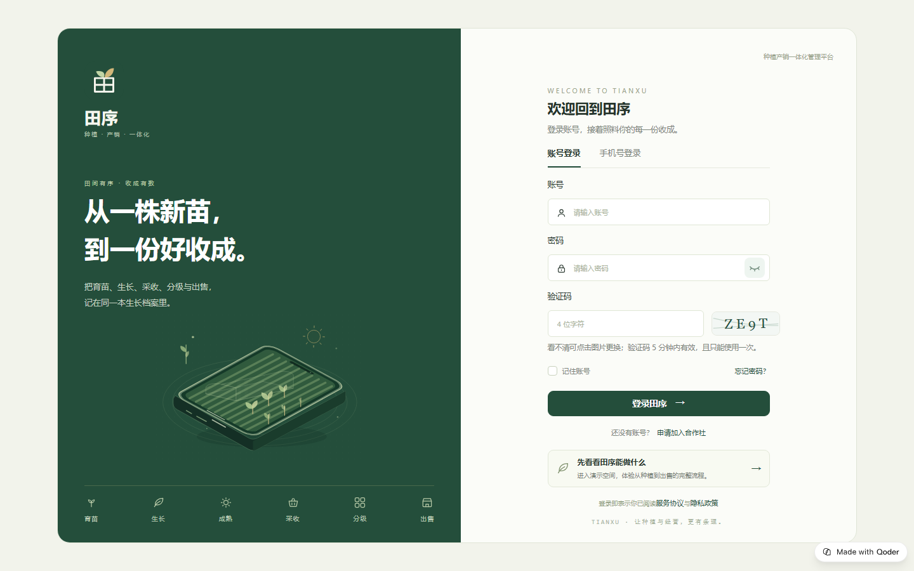
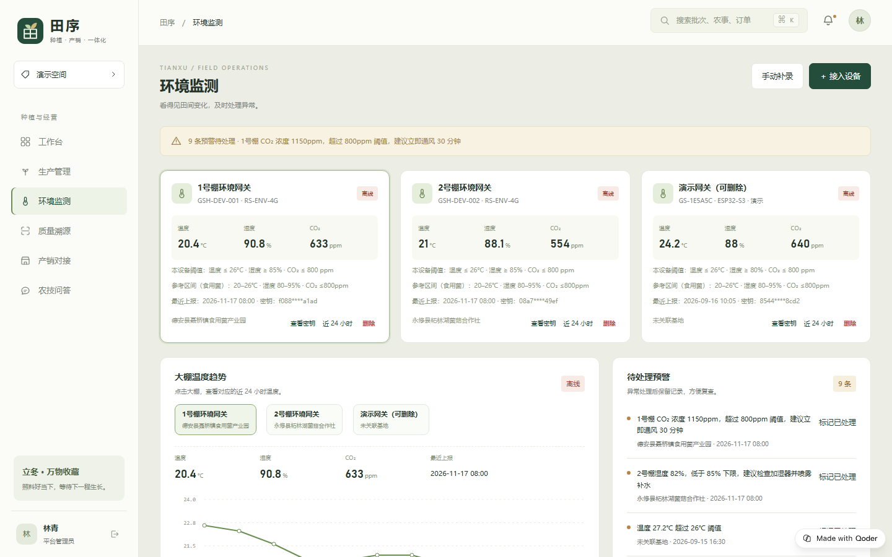
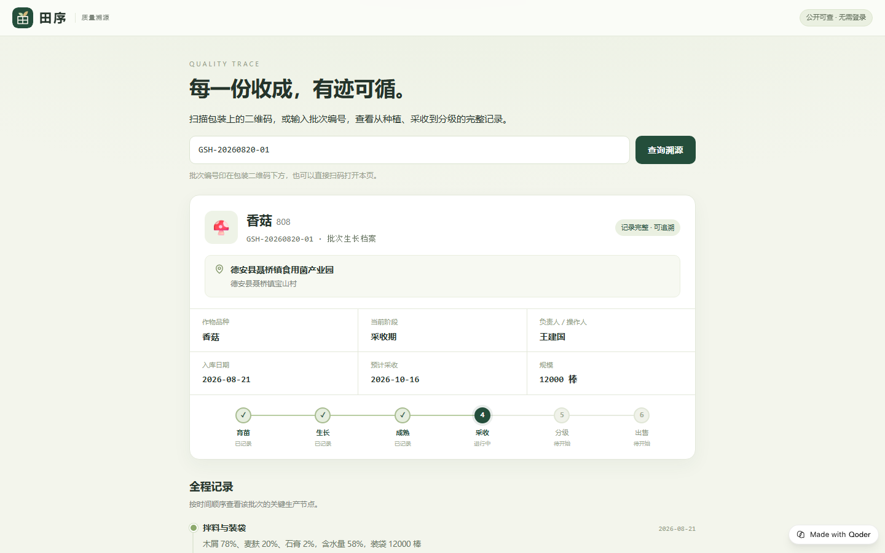
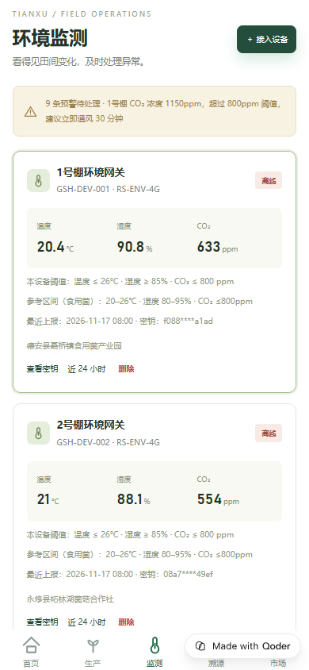

# 田序 · 种植产销一体化管理台

> 给每一批收成建一份生长档案，从田间一路查到餐桌。
> 2026 Qoder 高校创造力大赛 · **Hack4Good 技术向善** 参赛作品

[](https://tianxu-farm-4qx6jvn6rwk.qoder.website)


田序是一套面向县域种植合作社、家庭农场与小农户的**种植产销一体化管理系统**，把基地、批次、环境、溯源、产销与农技问答纳入同一条数据链：移动端负责现场录入，桌面端负责管理与协同，产销模块完成从供应发布、在线下单到订单履约的完整交易闭环。

- **在线体验**：<https://tianxu-farm-4qx6jvn6rwk.qoder.website>（电脑 / 手机浏览器均可，无需安装）
- **演示账号**：`demo / demo123456`（平台管理员 · 林青），登录页也可点「先看看田序能做什么」直接进入
- **采购商账号**：`demo_buyer / demo123456`
- **演示批次**：`GSH-20260820-01`


## 功能概览

| 模块 | 能力 |
| --- | --- |
| 工作台 | 在产批次、今日待采收、待处理预警、田间环境概览；育苗—生长—成熟—采收—分级—出售六阶段流程 |
| 生产管理 | 基地与批次管理，农事记录按节点结构化录入（拌料、灭菌、接种、转房、采收……） |
| 环境监测 | 温湿度 / CO₂ 采集（MQTT 接入），超过作物阈值自动生成预警，支持标记处理与手动补录 |
| 质量溯源 | 以批次编号为唯一入口，展示六阶段档案、全程记录与产品溯源卡；批次二维码直达免登录的公开溯源页 |
| 产销对接 | 供应发布与下架、供应大厅采购、采购订单流转（待付款 / 待发货 / 待收货 / 已完成）、采购需求对接 |
| 农技问答 | 内置离线规则知识库，未配置密钥时也可问答；配置模型后自动切换，前端无需改动 |

## 界面预览

| 登录页 | 质量溯源 |
| --- | --- |
|  |  |

| 环境监测 | 公开溯源页（免登录） |
| --- | --- |
|  |  |

| 手机工作台 | 手机环境监测 |
| --- | --- |
|  |  |

## 技术栈

- **前端**：H5 单页应用（React 构建产物，桌面端左侧导航 + 手机端底部 5 个 tab，390px 宽度无横向滚动），另有 `public/` 下的管理端页面与独立公开溯源页 `trace.html`
- **后端**：Node.js + Express 4，单端口同时提供 `/api` 与 H5 静态资源
- **存储**：better-sqlite3（WAL 模式，单写者模型），自带 WAL 安全备份脚本
- **设备接入**：MQTT（适配层 + 可选内置 broker），支持温度、湿度、CO₂ 等传感器上报
- **鉴权**：JWT + 图形验证码，密钥缺失时自动生成并持久化到 `server/data/jwt.secret`
- **部署**：Docker / docker-compose + Caddy（自动 HTTPS），也可直接 `npm start`

## 目录结构

```text
.
├── server/            # Express 后台：路由、鉴权、设备、订单、AI 问答、种子数据、测试脚本
│   └── data/          # 运行时数据（SQLite、jwt.secret、备份），首次启动自动创建，不入库
├── public/            # 管理端页面 index.html 与公开溯源页 trace.html
├── demo/              # 离线静态演示站（Qoder Sites 发布产物，浏览器内 mock API）
├── docs/              # 参赛材料：作品帖、截图、封面
├── Dockerfile
├── docker-compose.yml
├── Caddyfile
└── DEPLOY.md          # 长期运行部署说明（自启、备份、拨测、更新）
```

## 快速开始

需要 Node.js ≥ 20（`better-sqlite3` 为原生模块，首次安装会下载预编译二进制）。

```bash
git clone https://github.com/<your-name>/tianxu.git
cd tianxu
cp .env.example .env          # 按需填写 AI / MQTT 配置，可全部留空
npm ci
npm run seed:demo             # 可选：写入演示数据
npm start                     # http://localhost:3000
```

- 根路径 `/` 指向 H5 演示站（`demo/` 未打包进后台时用 `H5_DIST` 指定其它目录）
- 管理端：`http://localhost:3000/admin/`
- 公开溯源页：`http://localhost:3000/trace?code=GSH-20260820-01`
- 健康检查：`GET /api/health`

### 常用脚本

| 命令 | 作用 |
| --- | --- |
| `npm start` | 启动服务 |
| `npm run dev` | 带 `--watch` 的开发模式 |
| `npm run seed:demo` | 写入演示数据 |
| `npm test` | 接口回归测试 |
| `npm run backup` | 备份数据库与上传文件 |
| `npm run mqtt` | 启动 MQTT 设备适配层 |

### Docker 部署

```bash
mkdir -p data uploads && chown -R 1000:1000 data uploads
cp .env.example .env
docker compose up -d --build
```

配置 `DOMAIN` 后由 Caddy 自动签发并续期 HTTPS 证书；无域名时直接用 `http://服务器IP`。长期运行的自启、每日备份、外部拨测与更新流程见 [DEPLOY.md](DEPLOY.md)。

## 离线演示站

`demo/` 是自包含的静态演示站：`demo-mock.js` 在浏览器内拦截 `/api/*`，把登录、列表、溯源、问答与增删改都落到 `demo-fixtures.js` 的演示数据上；所有操作只存在于当前页面内存，刷新后恢复预置样例，不写入任何服务器。可直接 `npx serve demo` 本地预览，或原目录发布到任意静态托管。

## 安全说明

- 仓库内**不含任何真实个人信息、密钥或生产数据**；`server/data/`、`uploads/`、`.env` 均已忽略
- 演示账号仅用于公开演示，正式部署请修改密码并设置独立的 `JWT_SECRET`
- 环境监测页明确标注「演示数据」，避免把静态样例误认为实时在线设备

## 参赛材料

- 作品帖（比赛格式稿）：[docs/tianchi-post.md](docs/tianchi-post.md)
- 截图：[docs/screenshots](docs/screenshots)
- 赛题页：<https://tianchi.aliyun.com/competition/entrance/532536>

## License

[MIT](LICENSE)
